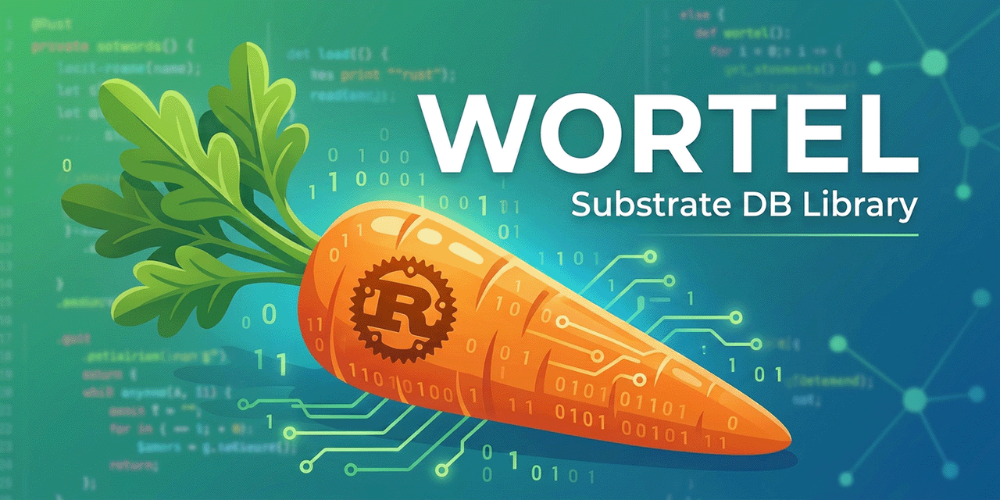

# wortel

Direct RocksDB reader for a subtensor (substrate) **archive node's** database.
Replaces the websocket round-trips substrate WS makes for storage queries with
local reads of the node's own DB — same keys in, same SCALE bytes out, so the
existing key construction and `scalecodec` decoding on the Python side work
unchanged.

Pinned to the exact polkadot-sdk revision subtensor builds against
(`RaoFoundation/polkadot-sdk @ a08c7b0f0b64`), so the trie codec, column
layout, and key schemes are correct by construction. When subtensor bumps its
revision, bump the `rev` in `Cargo.toml` and re-check `src/columns.rs` against
that revision's `sc-client-db`.

## What it maps to

| RPC used by substrate                                 | wortel                                               |
|-------------------------------------------------------|------------------------------------------------------|
| `state_getStorage`                                    | `get_storage(block_hash, key)`                       |
| batched storage queries (`query_multi`)               | `get_storage_many(block_hash, keys)`                 |
| `state_getKeysPaged` + N × `getStorage` (`query_map`) | `storage_pairs` / `iter_prefix` — one trie traversal |
| `chain_getHeader`                                     | `header(hash)` (raw SCALE)                           |
| `chain_getBlock` extrinsics                           | `extrinsics(hash)` / `body(hash)`                    |
| `chain_getBlockHash(n)`                               | `block_hash(n)`                                      |
| best / finalized head                                 | `best_block()` / `finalized_block()`                 |

Not covered: `runtime_call` (e.g. `StakeInfoRuntimeApi.get_stake_info_for_coldkeys`)
— those execute wasm and stay on the RPC path.

## Node requirements

- `--database rocksdb` (the default). ParityDB has no safe concurrent-reader story.
- `--state-pruning archive` (or the legacy `--pruning=archive`) — plain
  `archive`, not `archive-canonical`, or you'll have headers without
  historical state. A block whose state is missing raises a distinct
  `MissingState` error rather than "not found".
- DB path is the node's `.../chains/<chain-id>/db/full` directory.

## Open modes (tested against a live finney archive node, 4.2 TB, 143k SSTs)

**`readonly` (default).** Read-only open of the current on-disk snapshot.
Safe next to the running node; opens in ~20 s (~70 s with a cold OS page
cache) at a few hundred MB RSS. Frozen at open
time: later blocks and the un-flushed memtable are invisible, so the visible
head lags the node (make a new Reader to refresh). If the node's compaction
deletes an SST under you, calls raise a stale-snapshot error (`OSError` in
Python) — recreate the Reader and resume (open itself retries this
automatically). This is the right mode for backfills and historical reads.

**`secondary`.** A RocksDB secondary instance can follow the live node via
`catch_up()` (replays the node's WAL, so it also sees the memtable). Two
caveats, both hit in testing: RocksDB requires `max_open_files=-1` here, and
open replays the primary's entire MANIFEST edit log — after 5 weeks of node
uptime that log was 667 MB and the replay needed >20 GB of RAM (OOM).
Restarting the node rolls the MANIFEST to a compact snapshot, after which
secondary mode is viable until it grows again. Prefer `readonly` unless you
truly need sub-minute freshness.

**`primary`.** Read-write open; only for a stopped node or a snapshot copy.

wortel raises the process fd soft limit to the hard limit on open — an archive
DB holds >100k SST files.

## Benchmarks

Two runnable benchmarks live in `examples/`:

- `bench.rs` — times every read path against a node DB:
  `cargo run --release --example bench -- <db-path> [block] [mode]`
- `bench_vs_rpc.py` — races wortel against the node's own RPC on a large map
  and verifies a random sample of values byte-for-byte (needs the wheel
  installed and the RPC reachable).

Measured on the live finney archive node (4.2 TB, 143k SSTs, host NVMe) at
historical block 8,700,000, starting from a **cold OS page cache** — the
worst case:

| operation                     |    time | notes                                  |
|-------------------------------|--------:|----------------------------------------|
| open (readonly)               |  40.2 s | ~20 s once the page cache is warm      |
| `block_hash(n)`               |  5.0 µs | flat column, no trie                   |
| `header`                      |  112 µs | flat column, no trie                   |
| `extrinsics`                  |  2.6 ms | 15 extrinsics                          |
| point read, cold              |  5.5 ms | `Timestamp.Now`                        |
| point read, warm              |   25 µs | average of 1000                        |
| `Tempo` map                   | 12.9 ms | 129 pairs                              |
| `get_storage_many`            |  4.0 ms | 129 keys, one trie context             |
| `TotalHotkeyAlpha`, cold      |  72.3 s | 47,110 pairs — first-ever traversal is disk-bound |
| `TotalHotkeyAlpha`, block n−1 |   1.5 s | the incremental-ETL steady state       |
| same, paged ×10k              |   1.3 s | how `iter_prefix` consumes it          |

The one expensive line is the *first* traversal of a big map, which
random-reads across the whole state column. Consecutive blocks share almost
every trie node, so an ETL walking block-by-block pays that cost once per
process, then ~1.5 s per block.

`bench_vs_rpc.py` on the same block and map, against the node's own
(localhost) RPC:

| path                                                           |  time |
|----------------------------------------------------------------|------:|
| wortel `storage_pairs`, warm                                   | 1.4 s |
| wortel `storage_pairs`, adjacent block                         | 1.4 s |
| RPC `state_getKeysPaged`, keys only                            | 2.3 s |
| RPC keys + one `getStorage` per key (what `query_map` does)    |  68 s |

A random sample of 200 values came back **byte-identical** to the RPC's;
wortel returns the full 47,110-entry map ~35× faster, in one traversal.
Over a remote websocket (the current ETL setup) the gap widens further.

## Python

```bash
pip install maturin
maturin develop --release        # or: maturin build --release → wheel in target/wheels
```

```python
import wortel

r = wortel.Reader("/data/subtensor/chains/bittensor/db/full")  # readonly
num, head = r.best_block()

# Point read: SubtensorModule.Tempo[3]
key = wortel.storage_prefix("SubtensorModule", "Tempo") + wortel.twox_64_concat(
    (3).to_bytes(2, "little")
)
raw = r.get_storage(head, key)  # SCALE bytes, decode with scalecodec as today

# Full map, one traversal (what query_map does with N+1 RPCs):
for key, value in r.iter_prefix(
    head, wortel.storage_prefix("SubtensorModule", "Tempo")
):
    ...

# Refresh view of the chain: readonly mode → new Reader;
# secondary mode → r.catch_up()
r = wortel.Reader(db_path)
```

Keys can equally come from async-substrate-interface's metadata-driven
`create_storage_key` — wortel only sees bytes.

## RPC facade (`wortel.serve`)

A JSON-RPC websocket sidecar for the node host: storage/chain reads are
answered from a readonly Reader, everything else (`state_call`, metadata,
`system_*`, `author_*`, subscriptions) forwards 1:1 to the node's own RPC.
Clients built on async-substrate-interface work unchanged — only the endpoint
URL changes. Design: `docs/rpc-facade.md`.

```bash
pip install 'wortel[serve]'
wortel-serve --db /data/subtensor/chains/bittensor/db/full \
    --upstream ws://127.0.0.1:9944 --listen 0.0.0.0:9955
```

The facade reopens its Reader every `--refresh-interval` (default 60 s) and
swaps atomically, so the served head lags the node by up to that interval —
fine for cron ETL, wrong for head-subscription services (which should keep
using the node RPC directly). Conformance check against the node:
`python examples/facade_conformance.py --facade ws://… --node ws://…`.

## Rust

```rust
use wortel::{Wortel, OpenMode};

let r = Wortel::open("/data/.../db/full", OpenMode::ReadOnly)?;
let (n, head) = r.best_block()?.unwrap();
let pairs = r.storage_pairs(&head, &wortel::keys::storage_prefix("SubtensorModule", "Tempo"), None, None)?;
```

## Tests

`cargo test` builds a synthetic client DB (real LayoutV1 trie via the same
sp-trie the node uses, plus headers/lookup/meta/body columns) in a temp
RocksDB and exercises every read path against it.

## The name

**Wortel** is the Afrikaans word for *root*. It fits twice over: every storage
read here starts at a block's state **root** and walks the trie down from it,
and the library itself goes to the root of the stack — reading the node's own
database directly instead of asking over RPC. As a bonus, the last three
letters are an anagram of **ETL**, which is exactly what wortel was built to
feed.
